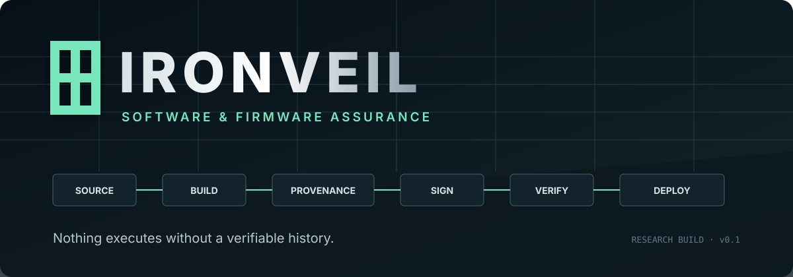
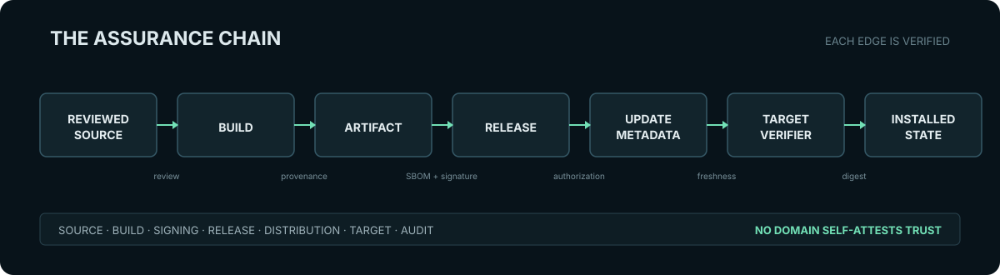
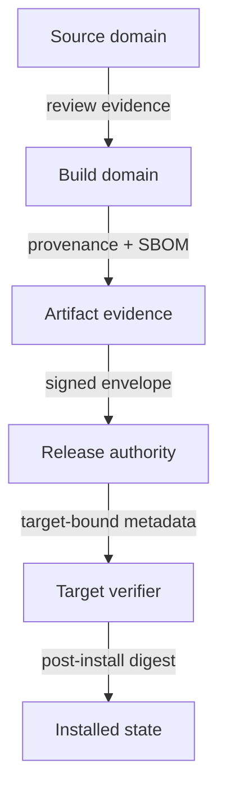
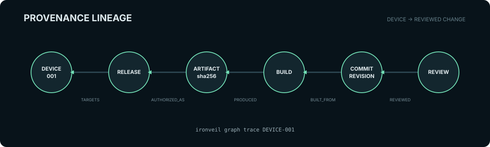
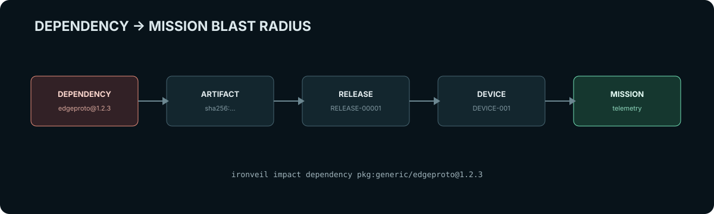
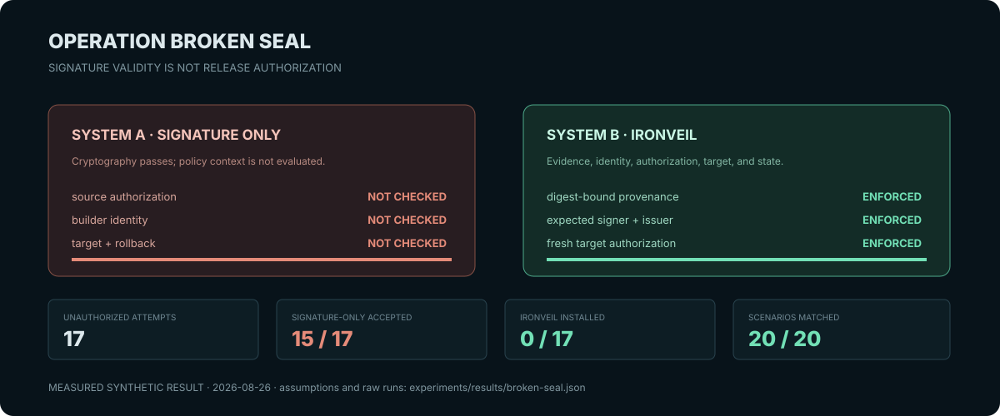

<div align="center">



# IRONVEIL

### End-to-End Software, Firmware, and Provenance Assurance for Critical Infrastructure

**Nothing executes without a verifiable history.**

[Quickstart](#quickstart) · [Threat model](#threat-model) · [Experiment](#operation-broken-seal) · [Reviewer path](docs/reviewer-guide.md) · [Whitepaper](docs/IRONVEIL-whitepaper.md)

</div>

---

A valid software signature cannot tell you whether the source was reviewed, whether the expected
builder produced the artifact, whether an unauthorized dependency entered the build, or whether the
artifact was authorized for the system receiving it.

> **IRONVEIL verifies the chain, not just the package.**

IRONVEIL is a defensive research platform for testing whether a software or firmware artifact has
enough independently verifiable evidence to move from authorized source to an industrial target.
Version 0.1 is a fully executable synthetic assurance lab: it builds the fictional VEILNODE-1 edge
gateway, constructs a digest-bound evidence package, evaluates a fail-closed release policy, tests 20
controlled supply-chain scenarios, traces lineage, and computes dependency-to-mission blast radius.

It does **not** claim that the artifact is vulnerability-free, that synthetic source controls reflect
live GitHub settings, that simulated update metadata is TUF-conformant, or that software measurement
is hardware secure boot.

## Research thesis

> Can a critical-infrastructure operator verify the complete trust history of software or firmware
> before deployment, even if individual supply-chain components are assumed capable of compromise?

The core proposition is deliberately strict:

```text
SIGNED ≠ TRUSTED
SBOM ≠ PROVENANCE
PROVENANCE ≠ DEPLOYMENT AUTHORIZATION
```

Trust is a policy decision over independently generated, cryptographically bound evidence—not a
boolean emitted by the pipeline that produced the artifact.

## Assurance chain



Each edge in this diagram maps to implemented evidence and an automated check:

| Link | Machine-verifiable evidence | Enforcement |
|---|---|---|
| Reviewed source | revision, repository, branch, author, independent reviewer, status checks | `source.authorization` |
| Source → build | source revision, build definition, builder, workflow, image, parameters | `INV-001.provenance-binding` |
| Build → artifact | in-toto statement type and digest-bound SLSA provenance subject | subject equality |
| Artifact → composition | CycloneDX 1.7-shaped SBOM bound to artifact digest | schema + ground-truth precision/recall |
| Artifact → signer | Ed25519 signature over the complete evidence envelope | crypto + trust-root + exact identity policy |
| Evidence → release | independent, expiring, target-bound authorization | deterministic release policy |
| Release → target | metadata freshness, version, role, target group, maintenance window | update gate |
| Target → installed state | intended and observed digest, version, last-known-good state | drift and recovery logic |

## Why signatures are insufficient

The flagship comparison isolates this failure mode. A cryptographically valid signature can still
cover an artifact built from unapproved source, produced by an unexpected builder, missing required
composition evidence, authorized for the wrong target, or older than the installed release.

IRONVEIL first verifies cryptography, then separately asks whether the signer, source, builder,
workflow, evidence set, release authority, target, and time window were expected. A valid signature
from an unauthorized identity fails invariant `INV-002`.

## Threat model

The model covers source and reviewer compromise, repository-control drift, dependency substitution
and confusion, build or input substitution, artifact and provenance replay, signer misuse, registry
substitution, update-metadata replay, rollback and freeze, wrong-target delivery, SBOM manipulation,
vulnerability-evidence tampering, and CI identity drift.

Controls are classified as **prevent**, **detect**, **limit**, **recover**, or **out of scope** in the
full [threat model](docs/threat-model.md). IRONVEIL does not claim to defeat a compromised verifier,
root of trust, policy authority, or trusted clock.

## Architecture



The trusted computing base is intentionally small: configured root metadata, the verifier, policy
evaluator, release authorization logic, target update gate, trusted clock assumptions, and exact
signing identities. See [architecture](docs/architecture.md) and [trust model](docs/trust-model.md).

## Trust domains

`SOURCE`, `BUILD`, `SIGNING`, `RELEASE`, `DISTRIBUTION`, `TARGET`, and `AUDIT` are modeled separately.
No ordinary build step receives the local private trust key. Signing does not create release
authorization, and distribution cannot change digest-pinned identity.

## VEILNODE-1

VEILNODE-1 is a deliberately small fictional edge gateway that aggregates synthetic pressure,
temperature, and flow telemetry. Its value is the artifact lifecycle—not its product functionality.

The deterministic builder consumes two explicit inputs:

- `veilnode/application/main.py`
- `veilnode/firmware/manifest.json`

It emits canonical JSON with no embedded timestamp. The test suite performs two independent builds
and requires byte-for-byte equality.

## Source assurance

The local source evidence object records repository, revision, author, reviewers, protected-branch
state, status checks, and evidence references. The policy requires an independent reviewer and both
`ci` and `security` checks. These properties are marked `simulated: true`; IRONVEIL does not infer a
SLSA Source level from configuration alone.

## Build provenance

Build evidence uses the in-toto Statement v1 envelope and SLSA provenance v1 predicate identifier.
The verifier requires an exact artifact subject digest, source revision, repository, builder identity,
workflow ref, build definition, build image, parameters, and environment.

```bash
ironveil provenance verify golden
```

This proves properties inside the local model. Hosted platform-generated provenance remains an
integration milestone; Build L2/L3 is not claimed.

## SBOM and VEX

The release carries a CycloneDX 1.7-shaped JSON SBOM with package URLs, component hashes, licenses,
scopes, and dependency relationships. IRONVEIL does not trust its declaration blindly: the verifier
compares it to `standards/dependency-ground-truth.json` and reports precision, recall, unknown
components, and missing components.

Vulnerability states distinguish `AFFECTED`, `NOT_AFFECTED`, `FIXED`, and `UNDER_INVESTIGATION`.
`NOT_AFFECTED` requires a justification; affected findings block the protected path.

## Signing identity

Local mode generates an ephemeral Ed25519 key below the ignored `.ironveil/trust/` directory. The
signature binds the artifact digest and the digests of source, provenance, SBOM, security,
authorization, and update evidence. Verification requires the configured public trust root and exact
identity and issuer—never a wildcard.

Hosted mode is designed for Sigstore keyless signing with GitHub OIDC, Fulcio, Rekor, and portable
bundles. It is not activated or claimed in v0.1.

## Release authorization

Signing and release approval are independent. An expiring release object binds the artifact digest,
source revision, required evidence set, approver, and authorized target groups. The policy returns only
`ALLOW`, `DENY`, `REVIEW_REQUIRED`, or `RECOVER`; missing critical evidence is fail-closed.

## Secure update architecture

The target gate evaluates artifact identity, update role authorization, metadata version and
expiration, target binding, minimum and installed versions, maintenance state, and explicit recovery
authorization. These are executable TUF/Uptane-inspired security semantics labeled
`SIMULATED_TUF_SEMANTICS`. Full python-tuf repository/client operation and Uptane conformance are not
claimed.

## Target and installed-state verification

Synthetic device classes include `VEILNODE-GATEWAY`, `VEILNODE-SENSOR`, and
`VEILNODE-CONTROLLER`. The golden fixture targets `DEVICE-GROUP-A` on `VEILNODE-GATEWAY`.

`ironveil update apply` writes state only after full-chain `ALLOW`. Post-install verification compares
the installed digest with the authorized release digest and reports `DEPLOYMENT_DRIFT` otherwise.
The boot measurement is explicitly `SIMULATED`.

## Provenance graph



```bash
ironveil graph trace DEVICE-001
```

The query returns each `REVIEWED`, `BUILT_FROM`, `PRODUCED`, `AUTHORIZED_AS`, and `TARGETS` edge from
the reviewed change to the device.

## Supply-chain blast radius



```bash
ironveil impact dependency pkg:generic/edgeproto@1.2.3
ironveil recall component pkg:generic/edgeproto@1.2.3
```

The graph resolves affected artifacts, releases, devices, and mission functions. This makes
provenance an incident-response asset rather than only release documentation.

## Scenario catalog

| ID | Mutation | Required outcome |
|---|---|---|
| SCN-001 | Golden release | ALLOW / INSTALL |
| SCN-002 | Unauthorized source revision | DENY |
| SCN-003 | Missing independent review | DENY |
| SCN-004 | Artifact substitution | DENY |
| SCN-005 | Provenance substitution | DENY |
| SCN-006 | Untrusted builder | DENY |
| SCN-007 | Dependency drift | DENY |
| SCN-008 | SBOM divergence | DENY |
| SCN-009 | Valid signature, wrong identity | DENY |
| SCN-010 | Registry/tag substitution | DENY |
| SCN-011 | Expired update metadata | DENY |
| SCN-012 | Unauthorized rollback | DENY |
| SCN-013 | Wrong target group | DENY |
| SCN-014 | Compromised online role | DENY |
| SCN-015 | Authorized key rotation | ALLOW |
| SCN-016 | Authorized recovery after failed health check | RECOVER |
| SCN-017 | Missing required SBOM | DENY |
| SCN-018 | Affected critical vulnerability | DENY |
| SCN-019 | Evidence tampering | DENY |
| SCN-020 | CI workflow identity drift | DENY |

All compromise behavior is a deterministic mutation of local fixtures. No network attack, external
registry modification, vendor impersonation, malicious firmware, persistence, or credential theft is
implemented.

## OPERATION BROKEN SEAL



The flagship experiment compares:

1. a cryptographic signature-only verifier that makes no source, builder, evidence, release, target,
   or freshness decision; and
2. IRONVEIL full-chain verification.

```bash
ironveil experiment run BROKEN-SEAL
```

The command executes the complete scenario catalog, calculates unauthorized-artifact acceptance,
provenance-break detection, target and rollback enforcement, SBOM ground-truth recall, and median
verification latency, then writes the measured result to
`experiments/results/broken-seal.json`. The committed result is regenerated during the quality gate;
it is not a hand-authored benchmark.

### Measured v0.1 result

| Metric | Result |
|---|---:|
| Supply-chain mutations tested | 17 |
| Unauthorized releases attempted | 17 |
| Unauthorized artifacts installed | **0** |
| Signature-only unauthorized acceptance | **15/17 (88.2%)** |
| IRONVEIL unauthorized acceptance | **0/17 (0%)** |
| Provenance-break detection | 100% |
| Target authorization accuracy | 100% |
| Rollback rejection | 100% |
| Signing identity enforcement | 100% |
| SBOM composition recall | 100% |
| Scenario outcomes matched | 20/20 |
| Median local verification latency | ~0.40 ms |

These values describe this deterministic synthetic suite under the documented assumptions—not all
real supply-chain attacks or production performance.

## Capability status

| Capability | v0.1 status |
|---|---|
| Deterministic VEILNODE artifact | VERIFIED |
| Synthetic source evidence and two-party policy | VERIFIED IN MODEL |
| Digest-bound SLSA-shaped build provenance | VERIFIED IN MODEL |
| CycloneDX 1.7-shaped SBOM + ground-truth evaluation | VERIFIED IN MODEL |
| Local Ed25519 evidence-envelope signing | VERIFIED / TEST-ONLY |
| Expected signer and issuer enforcement | VERIFIED IN MODEL |
| Release policy and target authorization | VERIFIED IN MODEL |
| Expiration, rollback, wrong-target, and recovery checks | VERIFIED IN MODEL |
| Dependency-to-mission impact graph | VERIFIED IN MODEL |
| Sigstore keyless hosted release | PLANNED |
| OCI publication | INTEGRATION BOUNDARY |
| TUF repository/client conformance | NOT CLAIMED |
| Uptane conformance | NOT CLAIMED |
| Hardware measured/secure boot | NOT CLAIMED |
| SLSA level | NOT SELF-AWARDED |

## Quickstart

Prerequisites: Python 3.12+ and [uv](https://docs.astral.sh/uv/). Docker is optional and used only for
the OCI integration profile.

```bash
git clone https://github.com/bbrookhart/ironveil.git
cd ironveil

make bootstrap
make test test-properties test-scenarios
make build verify
ironveil experiment run BROKEN-SEAL
```

## Working commands

```bash
ironveil status
ironveil source verify golden
ironveil build inspect .ironveil/artifacts/veilnode-1.0.0.json
ironveil provenance verify golden
ironveil sbom inspect golden
ironveil sbom verify golden
ironveil signature verify golden
ironveil release inspect RELEASE-00001
ironveil release verify RELEASE-00001
ironveil target inspect DEVICE-001
ironveil update verify RELEASE-00001 DEVICE-001
ironveil update apply RELEASE-00001 DEVICE-001
ironveil installed verify DEVICE-001
ironveil graph trace DEVICE-001
ironveil impact dependency pkg:generic/edgeproto@1.2.3
ironveil scenario list
ironveil scenario run SCN-004
ironveil evidence verify RELEASE-00001
```

## Evidence package

`make bootstrap` creates an ignored, reproducible package below
`.ironveil/evidence/RELEASE-00001/`. Its root manifest contains cryptographic digests of each source,
provenance, composition, security, signing, release, and update object. `ironveil evidence verify`
detects any post-generation change.

## Assurance case

Claims are structured as **claim → argument → evidence → assumptions**. A missing evidence object
degrades the claim and can never silently become `VERIFIED`. See the
[assurance case](docs/assurance-case.md) and [attack/control/evidence matrix](docs/assurance-case.md#attack--control--evidence-matrix).

## Standards and framework mappings

The machine-readable [standards registry](standards/registry.yaml) was retrieved on 2026-08-26 and
tracks exact version and status separately. Notable baselines are SLSA 1.2 Approved, NIST SSDF 1.1
Final, SSDF 1.2 Draft, NIST SP 800-161 Rev. 1 Update 1 Final, CISA 2026 SBOM Minimum Elements,
CycloneDX 1.7, in-toto 1.0, TUF 1.0.36, Uptane 2.1.0, and Sigstore Bundle 0.3.2.

Mappings are evidence traceability aids—not certification or compliance claims.

## Limitations

- The lab is synthetic and does not prove real GitHub branch protection, reviewer identity, or hosted
  builder hardening.
- The local signer is test-only and is not equivalent to Sigstore keyless identity, transparency-log
  inclusion, HSM-backed signing, or production PKI.
- The update model tests security semantics but does not use a conformant TUF client/repository yet.
- SBOM precision and recall are valid only against the included synthetic ground truth.
- A complete provenance chain does not prove that source code is benign or vulnerability-free.
- The verifier trusts its policy, public root, filesystem, clock, and execution environment.
- Industrial hardware, safety interlocks, secure boot, TPM measurement, and real firmware flashing are
  outside v0.1.

See [research integrity](docs/research-integrity.md) and [full limitations](docs/limitations.md).

## Research roadmap

1. Replace simulated update metadata with python-tuf repository/client integration and threshold keys.
2. Add GitHub artifact attestations and exact Sigstore certificate/issuer/workflow verification.
3. Publish by immutable OCI digest and preserve offline-verifiable Sigstore bundles.
4. Add independent live source-control evidence without self-awarding a SLSA Source level.
5. Integrate measured boot on compatible lab hardware while preserving a clear simulation boundary.
6. Expand graph evaluation to multiple releases, suppliers, device classes, and mission functions.

## Responsible use

IRONVEIL is defensive. Use only synthetic fixtures or systems you own and are authorized to test.
Do not use it to impersonate vendors, target live firmware or registries, steal credentials, or attack
external build/update infrastructure. See [SECURITY.md](SECURITY.md).

## Citation

Use [CITATION.cff](CITATION.cff). IRONVEIL is a research artifact, not a government-endorsed product.

## License

Apache License 2.0. See [LICENSE](LICENSE).
